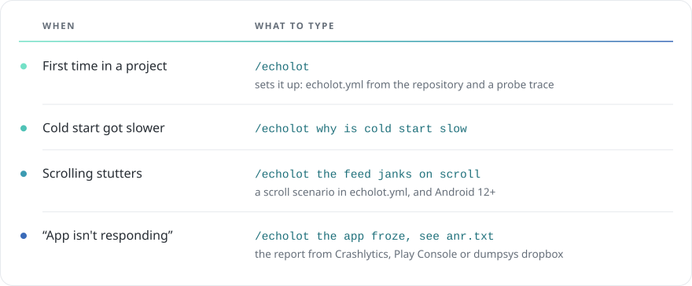
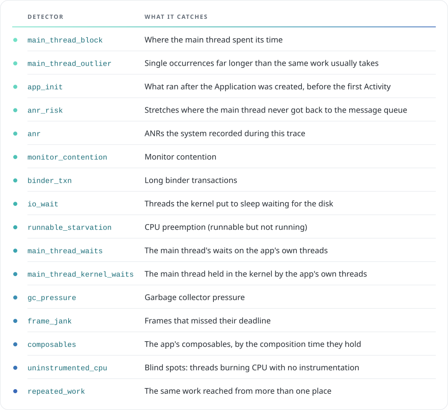

<p align="center">
  
</p>
<p align="center">
  Turns a huge Android trace into 20 rows of facts an AI agent can actually use.
</p>
<p align="center">
  <a href="https://github.com/grishan0v/echolot/actions/workflows/checks.yml"></a>
  <a href="https://pypi.org/project/echolot/"></a>
  <a href="https://pypi.org/project/echolot/"></a>
  <a href="https://github.com/grishan0v/echolot/blob/main/LICENSE"></a>
  <br>
  <a href="https://grishan0v.github.io/echolot/agent-layer/#installing-the-plugin"></a>
  <a href="https://grishan0v.github.io/echolot/agent-layer/#installing-the-plugin"></a>
  <a href="https://grishan0v.github.io/echolot/agent-layer/#installing-the-plugin"></a>
</p>
<p align="center">
  <a href="https://grishan0v.github.io/echolot/">Docs</a> ·
  <a href="https://github.com/grishan0v/echolot/releases">Releases</a> ·
  <a href="https://github.com/grishan0v/echolot/blob/main/CONTRIBUTING.md">Contributing</a>
  <br>
  <b>English</b> · <a href="https://github.com/grishan0v/echolot/blob/main/README.ru.md">Русский</a>
</p>
<br>

- **Finds the line to fix.** From a slow screen to a file and line, with the
  numbers that prove it.
- **Same answer, every run.** A pinned `trace_processor`: the same trace always
  gives the same report.
- **No tracing code needed.** Works on apps with zero `trace {}` calls; it
  places temporary markers itself.
- **Works with your agent.** A plugin for Claude Code, Codex and Cursor; any
  other agent via `echolot guide`.

A large Kotlin app's cold start, five repeats with default thresholds: twelve
detectors fired with 255 rows. `report.json` keeps them all in about 240 KB,
and the overview the agent reads first is about 3.5 KB. Fifteen cold starts
are read in about nine seconds.

## Quick start

```bash
pipx install echolot
```

Then the plugin, for the agent you use:

```bash
# Claude Code
claude plugin marketplace add grishan0v/echolot
claude plugin install echolot@echolot

# Codex
codex plugin marketplace add grishan0v/echolot
codex plugin add echolot@echolot

# Cursor: a copy in its folder for local plugins, then restart Cursor
echolot plugin cursor
```

Cursor also loads the plugins Claude Code has installed and enabled, so with
the plugin in Claude Code there is nothing to copy.

Open the agent in your Android project and say what is wrong:

<p>
  <picture>
    <source media="(max-width: 767px)" srcset="https://raw.githubusercontent.com/grishan0v/echolot/main/docs/assets/ask-narrow.svg">
    
  </picture>
</p>

<details>
<summary>The table as text</summary>

- First time in a project: `/echolot` (sets it up: echolot.yml from the repository and a probe trace)
- Cold start got slower: `/echolot why is cold start slow`
- Scrolling stutters: `/echolot the feed janks on scroll` (a scroll scenario in echolot.yml, and Android 12+)
- “App isn't responding”: `/echolot the app froze, see anr.txt` (the report from Crashlytics, Play Console or dumpsys dropbox)

</details>

With the plugin, the command is `/echolot:echolot` in Claude Code,
`$echolot` in Codex and `/echolot` in Cursor. Without it, `echolot init` puts `/echolot` into the
project's `.claude/` and points other agents at `echolot guide`; see
[The agent layer](https://grishan0v.github.io/echolot/agent-layer/).

## Without an agent

```bash
# record the scenario five times, and build the report from those traces
echolot collect -c echolot.yml -n 5
echolot analyze .echolot/traces/coldStart_iter*.perfetto-trace -c echolot.yml

# what changed since an earlier report
echolot compare before.json .echolot/out/report.json
```

In CI, one step after the benchmark analyzes its traces and compares them with
the report the last good run kept:

```yaml
- uses: grishan0v/echolot@v0.18.0
  with:
    traces: app/benchmark/build/outputs/**/StartupBenchmark_startup_iter*.perfetto-trace
```

## What it catches

echolot runs sixteen SQL detectors over a Perfetto trace. Each one that finds
something becomes a section of the report:

<p>
  <picture>
    <source media="(max-width: 767px)" srcset="https://raw.githubusercontent.com/grishan0v/echolot/main/docs/assets/detectors-narrow.svg">
    
  </picture>
</p>

<details>
<summary>The table as text</summary>

- `main_thread_block`: Where the main thread spent its time
- `main_thread_outlier`: Single occurrences far longer than the same work usually takes
- `app_init`: What ran after the Application was created, before the first Activity
- `anr_risk`: Stretches where the main thread never got back to the message queue
- `anr`: ANRs the system recorded during this trace
- `monitor_contention`: Monitor contention
- `binder_txn`: Long binder transactions
- `io_wait`: Threads the kernel put to sleep waiting for the disk
- `runnable_starvation`: CPU preemption (runnable but not running)
- `main_thread_waits`: The main thread's waits on the app's own threads
- `main_thread_kernel_waits`: The main thread held in the kernel by the app's own threads
- `gc_pressure`: Garbage collector pressure
- `frame_jank`: Frames that missed their deadline
- `composables`: The app's composables, by the composition time they hold
- `uninstrumented_cpu`: Blind spots: threads burning CPU with no instrumentation
- `repeated_work`: The same work reached from more than one place

</details>

## What you get

`report.md` for you and `report.json` for the agent, in `.echolot/out/`.
The agent reads it through `echolot report`: an overview of one line per
detector, and each detector's rows one command away, ranked by the median
times the share of repeats that found them. The repeats of a set are read
side by side, each in a trace_processor of its own.
`echolot analyze --html` adds `report.html`: the same report in plain words as
a page, one file that opens from disk. `echolot hunt --show --html`
writes an investigation the same way: what the agent found, where, and what to change.
`echolot compare --html` does it for two reports: did it get better, and which checks moved.
`echolot ui` opens a page on this machine with whether everything is ready, a
button that records and analyses the app, the reports and the agent's answers.
In a project with no config yet it writes the first one, for how the app opens.
From a report it starts your own Claude Code or Codex on the checks you tick,
and shows its rounds as they come in.

<details>
<summary><b>Example report</b></summary>

```markdown
# Marker Report

Runs: **5**, numbers are medians across them
Traces: `coldStart_iter000`, `coldStart_iter001`, `coldStart_iter002`, `coldStart_iter003`, `coldStart_iter004`
Scenario: `coldStart`
Process: `com.example.app` (pid 12903 in `coldStart_iter000`, the first of 5)
Scenario window: **1136.05 ms** (from 1084.25 to 1214.18 across repeats)
Main thread: 40% on a CPU · 1% waiting for a CPU · 9% blocked in the kernel · 49% sleeping
Covered by the findings below: **42%** of the main thread's window, each moment counted once
Startup: cold, **1174 ms** from the launch to the first frame: 42% sleeping · 17% `choreographer_do_frame` · 17% `inflate` · 6% blocked in the kernel · 5% `monitor_contention` · 3% `launch_delay` · 2% `bind_application` · 2% `activity_start`
That is the platform's measure rather than the window: the startup began 38 ms before the window opened, and ended with it.
Device: clock **1478 MHz** (from 1325 to 1574 across repeats), peak 54 °C, 1514 MB free at the low point
Detectors fired: **5 of 16**
> ⚠️ 1 detector(s) could not run, because the trace does not hold what they read. Their silence says nothing about the app. `composables` — The recording does not carry the names of composables, which have to be switched on when recording. A recording that holds what they read lets them look; until then those checks are open.
Config: `/home/you/my-app/echolot.yml` (sha ce502af692b8) · thresholds: built-in defaults

## Markers
_the names `domains` lists and the `AGENTTMP_` ones; medians per run, self time with children subtracted_

| Marker | Runs | N | Self, ms | Total, ms | Max, ms | Threads |
|---|---|---|---|---|---|---|
| collection_load | 5/5 | 1 | 923.8 | 923.8 | 971.63 | (async) |
| collection_mapping | 5/5 | 1 | 96.0 | 118.3 | 132.5 | arch_disk_io_1 |

## Frames that missed their deadline
_the platform classifies every frame itself, and says whose fault it was. The only detector that answers "which frames stuttered" rather than "where did the total go" — and it needs no instrumentation in the app at all._

| Where | Runs | N | Total, ms | Max of any run, ms | Evidence |
|---|---|---|---|---|---|
| App Deadline Missed | 5/5 | 4 | 427.51 | 172.0 | Self Jank · 4 of 19 frames · longest 188.7 ms |

<sub>detector `frame_jank`, params: {'min_frames': 3, 'min_overrun_ms': 4}</sub>

## Where the main thread spent its time
_measured as SELF time, children subtracted — otherwise one event lands in the report several times at different depths and the agent counts it twice_

| Where | Runs | N | Self, ms | Total, ms | Max of any run, ms | Evidence |
|---|---|---|---|---|---|---|
| inflate | 5/5 | 15 | 222.68 | 241.38 | 86.2 | com.example.app |
| draw | 5/5 | 7 | 120.8 | 120.8 | 38.08 | com.example.app |
| TextLayout:initLayout | 5/5 | 51 | 73.95 | 73.95 | 1.62 | com.example.app |
| Lock contention on a monitor lock (owner tid: #) | 5/5 | 9 | 61.6 | 61.6 | 25.09 | com.example.app |

<sub>detector `main_thread_block`, params: {'min_slice_ms': 16}</sub>

## Single occurrences far longer than the same work usually takes
_the pair to main_thread_block. That one asks where the main thread's time went in total; this one asks which single occurrence was out of line with its own history. A heavy tail hides from every sum._

| Where | Runs | N | Total, ms | Max of any run, ms | Evidence |
|---|---|---|---|---|---|
| inflate | 2/5 | 1 | 86.2 | 86.2 | median 12.1 ms of 15 · worst 7.1× |

<sub>detector `main_thread_outlier`, params: {'factor': 4, 'min_abs_ms': 40, 'min_occurrences': 5}</sub>

## Monitor contention
_ART writes a "Lock contention on ..." slice with the owner's tid — ready-made evidence_

| Where | Threads | Runs | N | Total, ms | Max of any run, ms | In the code | Evidence |
|---|---|---|---|---|---|---|---|
| main | 1 | 5/5 | 9 | 61.6 | 25.09 | owner at StoreRepository.kt:30 · blocked at StoreRepository.kt:61 | monitor contention with owner DefaultDispatcher-worker-3 (12931) at void com.example.app.data.StoreRepository.update(com.example.app.data.Item)(StoreRepository.kt:30) waiters=0 blocking from com.example.app.data.Item com.example.app.data.StoreRepository.find(long)(StoreRepository.kt:61) · owner: running 100% |

<sub>detector `monitor_contention`, params: {'min_block_ms': 8, 'max_total_ms': 50, 'name_glob': 'Lock contention on a monitor lock*', 'name_glob_alt': 'monitor contention with owner*'}</sub>

## Blind spots: threads burning CPU with no instrumentation
_names a thread that burns CPU with no slice around it. The agent does not guess — it is handed the fact "thread T ran for 340 ms, zero slices". That is exactly where adding trace{} pays off._

| Where | Threads | Runs | N | Total, ms | Instrumented, ms | Evidence |
|---|---|---|---|---|---|---|
| DefaultDispatch | 1 | 5/5 | 0 | 522.09 | 0.0 | 100.0% of CPU outside slices |

<sub>detector `uninstrumented_cpu`, params: {'min_running_ms': 50, 'max_covered_pct': 50}</sub>

**Silent:** anr, anr_risk, app_init, binder_txn, gc_pressure, io_wait, main_thread_kernel_waits, main_thread_waits, repeated_work, runnable_starvation

<sub>trace_processor v59.1</sub>
```

What `analyze` prints in a terminal for the demo that comes with echolot: five cold starts
of an app that does not exist, built by code.

</details>

## Requirements

- Python 3.10 or newer, with `adb` and `curl` on `PATH`
- a phone or emulator with USB debugging on; Android 12+ for `frame_jank`
- git 2.36 or newer, for Claude Code to install the plugin

The first command that needs `trace_processor` downloads it once: 11–16 MB,
checked against its SHA-256. Offline or behind a proxy, see
[Determinism](https://grishan0v.github.io/echolot/determinism/).

## Documentation

[grishan0v.github.io/echolot](https://grishan0v.github.io/echolot/), with a
search, or the same pages [on GitHub](https://github.com/grishan0v/echolot/tree/main/docs):
[Collecting](https://grishan0v.github.io/echolot/collecting/) ·
[ANRs](https://grishan0v.github.io/echolot/anr/) ·
[Marking](https://grishan0v.github.io/echolot/mark/) ·
[The page in the browser](https://grishan0v.github.io/echolot/ui/) ·
[Analysing](https://grishan0v.github.io/echolot/analysing/) ·
[Comparing](https://grishan0v.github.io/echolot/compare/) ·
[Calibrating](https://grishan0v.github.io/echolot/calibrate/) ·
[Determinism](https://grishan0v.github.io/echolot/determinism/) ·
[The agent layer](https://grishan0v.github.io/echolot/agent-layer/) ·
[Privacy](https://grishan0v.github.io/echolot/privacy/) ·
[Terms of use](https://grishan0v.github.io/echolot/terms/) ·
[Detectors](https://grishan0v.github.io/echolot/detectors/) ·
[Reflect](https://grishan0v.github.io/echolot/reflect/)

## Help and contributing

echolot is alpha software, as its classifier on PyPI says
(`Development Status :: 3 - Alpha`), and it changes from release to release:
[Releases](https://github.com/grishan0v/echolot/releases) lists what each one
changed.

- **A question, or an idea not ready to be an issue:**
  [Discussions](https://github.com/grishan0v/echolot/discussions).
- **A bug or an improvement:** an [issue](https://github.com/grishan0v/echolot/issues),
  from its template. Every open issue is a card on the
  [Echolot Roadmap](https://github.com/users/grishan0v/projects/1).
- **A change of your own:**
  [CONTRIBUTING](https://github.com/grishan0v/echolot/blob/main/CONTRIBUTING.md)
  says how to run the checks and open a pull request. Everyone taking part
  follows the [Code of Conduct](https://github.com/grishan0v/echolot/blob/main/CODE_OF_CONDUCT.md).
- **A vulnerability:** privately, the way
  [SECURITY](https://github.com/grishan0v/echolot/blob/main/SECURITY.md) says,
  not in an issue.

## License

[MIT](https://github.com/grishan0v/echolot/blob/main/LICENSE)
