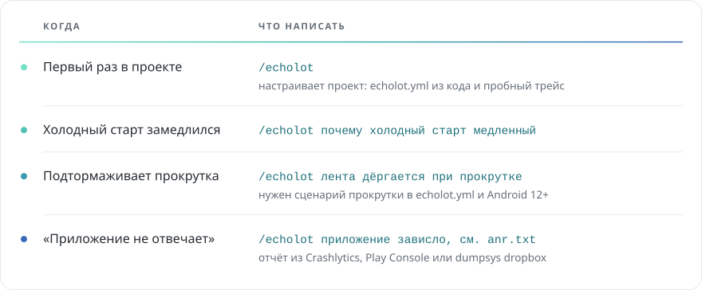

<p align="center">
  
</p>
<p align="center">
  Превращает огромный Android-трейс в 20 строк фактов, с которыми реально может работать AI-агент.
</p>
<p align="center">
  <a href="https://github.com/grishan0v/echolot/actions/workflows/checks.yml"></a>
  <a href="https://pypi.org/project/echolot/"></a>
  <a href="https://pypi.org/project/echolot/"></a>
  <a href="https://github.com/grishan0v/echolot/blob/main/LICENSE"></a>
  <br>
  <a href="https://github.com/grishan0v/echolot/blob/main/docs/ru/agent-layer.md#установка-плагина"></a>
  <a href="https://github.com/grishan0v/echolot/blob/main/docs/ru/agent-layer.md#установка-плагина"></a>
  <a href="https://github.com/grishan0v/echolot/blob/main/docs/ru/agent-layer.md#установка-плагина"></a>
</p>
<p align="center">
  <a href="https://github.com/grishan0v/echolot/blob/main/README.md">English</a> · <b>Русский</b>
</p>
<br>

- **Находит конкретную строку для исправления.** От медленного экрана до файла и строки с цифрами, которые это подтверждают.
- **Один и тот же ответ при каждом запуске.** Зафиксированная версия `trace_processor`: один и тот же трейс всегда даёт одинаковый отчёт.
- **Не требует кода трассировки.** Работает с приложениями вообще без вызовов `trace {}`; при необходимости сам расставляет временные маркеры.
- **Работает с вашим агентом.** Плагин для Claude Code, Codex и Cursor; любой другой агент — через `echolot guide`.

## Быстрый старт

```bash
pipx install echolot
```

Затем установите плагин для агента, которым пользуетесь:

```bash
# Claude Code
claude plugin marketplace add grishan0v/echolot
claude plugin install echolot@echolot

# Codex
codex plugin marketplace add grishan0v/echolot
codex plugin add echolot@echolot

# Cursor: копирует плагин в локальную папку, затем перезапустите Cursor
echolot plugin cursor
```

Cursor также подхватывает плагины, установленные и включённые в Claude Code, поэтому если плагин уже установлен в Claude Code, копировать ничего не нужно.

Откройте агента в вашем Android-проекте и опишите проблему:

<p>
  <picture>
    <source media="(max-width: 767px)" srcset="https://raw.githubusercontent.com/grishan0v/echolot/main/docs/assets/ru/ask-narrow.svg">
    
  </picture>
</p>

С плагином команда вызывается как `/echolot:echolot` в Claude Code, `$echolot` в Codex и `/echolot` в Cursor. Без плагина `echolot init` добавляет `/echolot` в `.claude/` проекта и направляет остальных агентов в `echolot guide`; подробнее см. [Слой агента](https://github.com/grishan0v/echolot/blob/main/docs/ru/agent-layer.md).

## Без агента

```bash
# записать сценарий пять раз и построить отчёт по этим трейсам
echolot collect -c echolot.yml -n 5
echolot analyze .echolot/traces/coldStart_iter*.perfetto-trace -c echolot.yml

# что изменилось по сравнению с предыдущим отчётом
echolot compare before.json .echolot/out/report.json
```

В CI один шаг после бенчмарка анализирует его трейсы и сравнивает их с отчётом последнего успешного прогона:

```yaml
- uses: grishan0v/echolot@v0.17.0
  with:
    traces: app/benchmark/build/outputs/**/StartupBenchmark_startup_iter*.perfetto-trace
```

## Что он находит

echolot запускает 16 SQL-детекторов по Perfetto-трейсу. Каждый сработавший детектор формирует раздел отчёта:

<p>
  <picture>
    <source media="(max-width: 767px)" srcset="https://raw.githubusercontent.com/grishan0v/echolot/main/docs/assets/ru/detectors-narrow.svg">
    
  </picture>
</p>

## Что вы получаете

`report.md` для человека и `report.json` для агента в каталоге `.echolot/out/`.
Трейс объёмом 81 МБ с 475 тысячами срезов превращается в `report.json` на 14 КБ примерно за пять секунд. `echolot analyze --html` создаёт `report.html`: тот же отчёт простым языком в виде одного автономного файла, который открывается прямо с диска. `echolot hunt --show --html` аналогично оформляет расследование: что агент нашёл, где и что поменять.
`echolot compare --html` строит страницу сравнения двух отчётов: стало ли быстрее и какие проверки сдвинулись.
`echolot ui` открывает локальную веб-страницу со статусом готовности окружения, кнопкой для записи и анализа приложения, отчётами и ответами агента.
В проекте без конфигурации он сам создаст начальную конфигурацию для запуска приложения.

<details>
<summary><b>Пример отчёта</b></summary>

```markdown
# Marker Report

Runs: **5**, numbers are medians across them
Traces: `coldStart_iter000`, `coldStart_iter001`, `coldStart_iter002`, `coldStart_iter003`, `coldStart_iter004`
Scenario: `coldStart`
Process: `com.example.app` (pid 12903)
Scenario window: **1136.05 ms** (from 1084.25 to 1214.18)
Main thread: 40% on a CPU · 1% waiting for a CPU · 9% blocked in the kernel · 49% sleeping
Covered by the findings below: **42%** of the main thread's window, each moment counted once
Startup: cold, **1174 ms** from the launch to the first frame: 42% sleeping · 17% `choreographer_do_frame` · 17% `inflate` · 6% blocked in the kernel · 5% `monitor_contention` · 3% `launch_delay` · 2% `bind_application` · 2% `activity_start`
That is the platform's measure rather than the window: the startup began 38 ms before the window opened, and ended with it.
Device: clock **1478 MHz** (from 1325 to 1574 across repeats), peak 54 °C, 1514 MB free at the low point
Detectors fired: **5 of 16**
> ⚠️ 1 detector(s) could not run, because the trace does not hold what they read. Their silence says nothing about the app. `composables` — The recording does not carry the names of composables, which have to be switched on when recording. A recording that holds what they read lets them look; until then those checks are open.
Config: `/home/you/my-app/echolot.yml` (sha 3d78738defec) · thresholds: built-in defaults

## Markers
_the names `domains` lists and the `AGENTTMP_` ones; medians per run, self time with children subtracted_

| Marker | Runs | N | Self, ms | Total, ms | Max, ms | Threads |
|---|---|---|---|---|---|---|
| collection_load | 5/5 | 1 | 923.8 | 923.8 | 923.8 | (async) |
| collection_mapping | 5/5 | 1 | 96.0 | 118.3 | 118.3 | arch_disk_io_1 |

## Frames that missed their deadline
_the platform classifies every frame itself, and says whose fault it was. The only detector that answers "which frames stuttered" rather than "where did the total go" — and it needs no instrumentation in the app at all._

| Where | Runs | N | Total, ms | Max, ms | Evidence |
|---|---|---|---|---|---|
| App Deadline Missed | 5/5 | 4 | 427.51 | 130.89 | Self Jank · 4 of 19 frames · longest 188.7 ms |

<sub>detector `frame_jank`, params: {'min_frames': 3, 'min_overrun_ms': 4}</sub>

## Where the main thread spent its time
_measured as SELF time, children subtracted — otherwise one event lands in the report several times at different depths and the agent counts it twice_

| Where | Runs | N | Self, ms | Total, ms | Max, ms | Evidence |
|---|---|---|---|---|---|---|
| inflate | 5/5 | 15 | 222.68 | 241.38 | 49.28 | com.example.app |
| draw | 5/5 | 7 | 120.8 | 120.8 | 34.0 | com.example.app |
| TextLayout:initLayout | 5/5 | 51 | 73.95 | 73.95 | 1.45 | com.example.app |
| Lock contention on a monitor lock (owner tid: 12931) | 5/5 | 9 | 61.6 | 61.6 | 22.4 | com.example.app |

<sub>detector `main_thread_block`, params: {'min_slice_ms': 16}</sub>

## Single occurrences far longer than the same work usually takes
_the pair to main_thread_block. That one asks where the main thread's time went in total; this one asks which single occurrence was out of line with its own history. A heavy tail hides from every sum._

| Where | Runs | N | Total, ms | Max, ms | Evidence |
|---|---|---|---|---|---|
| inflate | 2/5 | 1 | 86.2 | 86.2 | median 12.1 ms of 15 · worst 7.1× |

<sub>detector `main_thread_outlier`, params: {'factor': 4, 'min_abs_ms': 40, 'min_occurrences': 5}</sub>

## Monitor contention
_ART writes a "Lock contention on ..." slice with the owner's tid — ready-made evidence_

| Where | Runs | N | Total, ms | Max, ms | In the code | Evidence |
|---|---|---|---|---|---|---|
| com.example.app | 5/5 | 9 | 61.6 | 22.4 | owner at StoreRepository.kt:30 · blocked at StoreRepository.kt:61 | monitor contention with owner DefaultDispatcher-worker-3 (12931) at void com.example.app.data.StoreRepository.update(com.example.app.data.Item)(StoreRepository.kt:30) waiters=0 blocking from com.example.app.data.Item com.example.app.data.StoreRepository.find(long)(StoreRepository.kt:61) |

<sub>detector `monitor_contention`, params: {'min_block_ms': 8, 'max_total_ms': 50, 'name_glob': 'Lock contention on a monitor lock*', 'name_glob_alt': 'monitor contention with owner*'}</sub>

## Blind spots: threads burning CPU with no instrumentation
_names a thread that burns CPU with no slice around it. The agent does not guess — it is handed the fact "thread T ran for 340 ms, zero slices". That is exactly where adding trace{} pays off._

| Where | Runs | N | Total, ms | Instrumented, ms | Evidence |
|---|---|---|---|---|---|
| DefaultDispatch | 5/5 | 0 | 522.09 | 0.0 | 100.0% of CPU outside slices |

<sub>detector `uninstrumented_cpu`, params: {'min_running_ms': 50, 'max_covered_pct': 50}</sub>

**Silent:** anr, anr_risk, app_init, binder_txn, gc_pressure, io_wait, main_thread_kernel_waits, main_thread_waits, repeated_work, runnable_starvation

<sub>trace_processor v56.1</sub>
```

То, что `analyze` выводит для встроенного демо-приложения: пять холодных стартов несуществующего приложения, сгенерированных кодом.

</details>

## Требования

- Python 3.10 или новее, с `adb` и `curl` в `PATH`
- телефон или эмулятор с включённой отладкой по USB; Android 12+ для `frame_jank`
- git 2.36 или новее для установки плагина в Claude Code

Первая команда, которой нужен `trace_processor`, скачает его один раз: 10–14 МБ с проверкой SHA-256. Для работы офлайн или за прокси см. [Детерминизм](https://github.com/grishan0v/echolot/blob/main/docs/ru/determinism.md).

## Документация

[grishan0v.github.io/echolot/ru/](https://grishan0v.github.io/echolot/ru/), или те же страницы [на GitHub](https://github.com/grishan0v/echolot/tree/main/docs/ru):
[Сбор трейсов](https://github.com/grishan0v/echolot/blob/main/docs/ru/collecting.md) ·
[ANR](https://github.com/grishan0v/echolot/blob/main/docs/ru/anr.md) ·
[Маркировка](https://github.com/grishan0v/echolot/blob/main/docs/ru/mark.md) ·
[Страница в браузере](https://github.com/grishan0v/echolot/blob/main/docs/ru/ui.md) ·
[Анализ](https://github.com/grishan0v/echolot/blob/main/docs/ru/analysing.md) ·
[Сравнение](https://github.com/grishan0v/echolot/blob/main/docs/ru/compare.md) ·
[Калибровка](https://github.com/grishan0v/echolot/blob/main/docs/ru/calibrate.md) ·
[Детерминизм](https://github.com/grishan0v/echolot/blob/main/docs/ru/determinism.md) ·
[Слой агента](https://github.com/grishan0v/echolot/blob/main/docs/ru/agent-layer.md) ·
[Приватность](https://github.com/grishan0v/echolot/blob/main/docs/ru/privacy.md) ·
[Условия использования](https://github.com/grishan0v/echolot/blob/main/docs/ru/terms.md) ·
[Детекторы](https://github.com/grishan0v/echolot/blob/main/docs/ru/detectors.md) ·
[Рефлексия](https://github.com/grishan0v/echolot/blob/main/docs/ru/reflect.md)

Вопросы и идеи: [Обсуждения](https://github.com/grishan0v/echolot/discussions).

## Лицензия

[MIT](https://github.com/grishan0v/echolot/blob/main/LICENSE)
